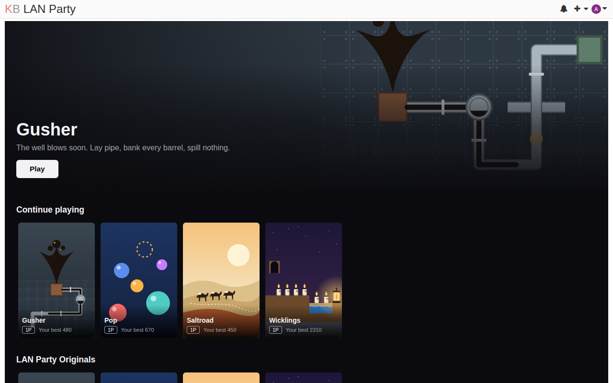

# LAN Party

A game launcher with leaderboards and challenges for your team, built into Kanboard. Browse rows of
game cards with cover art, play in the browser, and compete on per-game leaderboards.
Multiplayer rooms arrive in a later release.

## Install

Unzip the release into `plugins/LanParty` of your Kanboard install. The folder must be named
exactly `LanParty`: every game loads the SDK from `../../../LanParty/Assets/js/lanparty-sdk.js`.

- Kanboard >= 1.2.47
- PHP >= 8.4
- Recommended: the Agents plugin (>= 0.5.0) keeps agent users off the leaderboards.

## Web server

Games run in a sandboxed iframe, but a game file opened directly (a new tab, a pasted URL) is an ordinary page
on your Kanboard site. The SDK refuses to start there, and the web server should send it sandboxed too:

- **Apache:** nothing to do. `Games/.htaccess` sets `Content-Security-Policy: sandbox allow-scripts` when
  `mod_headers` is enabled (and `AllowOverride` permits it).
- **nginx:** add this to the Kanboard `server` block, above the static-file location
  (`location ~* ^.+\.(ico|jpg|…)$` in the stock config), so it covers every file under a `Games` folder:

  ```nginx
  location ~ /plugins/[^/]+/Games/ {
      add_header Content-Security-Policy "sandbox allow-scripts" always;
  }
  ```

  An `add_header` inside a location drops the server-level ones there; repeat any you rely on.

**HTTP Basic auth and SSO proxies.** The SDK's `asset()` fetches game files without credentials (so a game can
never receive a signed-in page). Behind HTTP Basic auth or an SSO proxy (oauth2-proxy, Authelia, Cloudflare
Access…) those fetches are refused and `asset()` rejects `unavailable`. Exempt `/plugins/*/Games/` from the
proxy's auth if your games use `asset()` (and check that the games' own scripts and styles load: the sandboxed
frame is cross-site, so a proxy cookie set `SameSite=Lax` or `Strict` is not sent with them either).

## Games

Four original games ship in `Games/`:

| Game | What it is |
|---|---|
| **Pop** | 30 seconds of rising bubbles; chain pops for a multiplier. |
| **Saltroad** | Lead a salt caravan to the coast: pace, rations, a seeded event deck and trading posts. Two routes. |
| **Gusher** | Lay pipe before the well blows: ten hand-made levels plus seeded endless boards. |
| **Wicklings** | Hand out five jobs to lead candle-folk to the lantern across twelve hand-made levels. |



Every game keeps a best-per-player leaderboard (all time and this week), saves progress per player, and can
share a challenge link that reopens the same level and seed.

Scores are client-reported, and that is an accepted limitation: the game in the browser computes them, so a
player who loads a game page can send any score from 0 to the game's `scoring.max`, earned or not. The server
accepts a score only with a single-use run token from the game page (one unused token per player and game, and,
when the game's manifest sets `scoring.min_seconds`, not sooner than that after the run began). That stops
replaying a score and scripted posting without loading the page; it does not check that a score was earned.
Admins moderate the boards under **Settings → LAN Party**: remove one player's scores for a game, or reset a
game's board.

### Adding a game

A game is a folder of static files (`game.json`, an entry page, cover art) that runs in a sandboxed iframe and
talks to the launcher only through `lanparty-sdk.js`. The rules are in
[docs/game-contract.md](https://github.com/carmelosantana/kanboard-lan-party/blob/main/docs/game-contract.md);
`Games/pop` is the smallest complete example.

- **Ship it in your own plugin (recommended).** Put the folder at `<YourPlugin>/Games/<slug>/` and append it to
  `$this->container['lanpartyGames']` in your plugin's `initialize()` (the contract shows the snippet). Your
  game survives LAN Party updates.
- **Contribute it to LAN Party.** Add `Games/<slug>/` here with tests, as the four shipped games do.

The registry checks each manifest and folder; a game that breaks a rule is skipped and logged, never shown.

## Development

```sh
./testing/run-plugin-tests.sh LanParty      # PHPUnit, from the plugin harness root
node --test LanParty/Test/js/*.test.mjs     # host bridge, SDK and game logic
```

## Licences

- Code: MIT (see `LICENSE`).
- Original game art: CC BY 4.0.

## Original games only

LAN Party ships original games and never bundles commercial game data. Open-source engine
ports live in a separate GPL pack.
